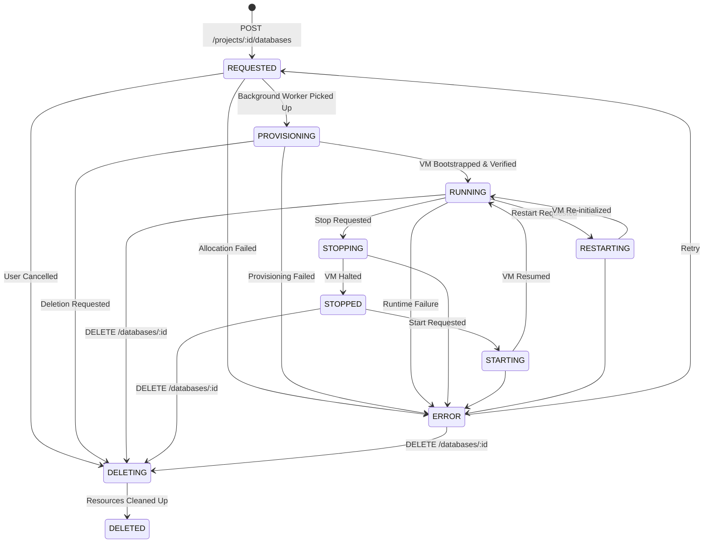

# Unified Multi-Database as a Service (Multi-DBaaS) — Backend

Production-oriented NestJS backend control plane for the Unified Multi-Database as a Service platform.

## 1. Project Purpose

Multi-DBaaS is a centralized Database as a Service platform enabling customers to provision, manage, and query databases (PostgreSQL, MongoDB, Qdrant, Neo4j) across isolated networks.

### Fundamental Architectural Principle
**NESTJS IS THE SINGLE GATEWAY.**
Customers **NEVER** directly connect to customer databases. All management operations, resource provisioning, and runtime queries pass exclusively through the NestJS backend gateway.

---

## 2. High-Level Architecture

```mermaid
graph TD
    Client[Customer / Developer / Dashboard] -->|HTTPS REST API| Gateway[NestJS Gateway API]
    Gateway -->|Verify ID Token| FirebaseAuth[Firebase Auth]
    Gateway -->|Multi-Tenant Auth & RBAC| AuthZ[Project Authorization Service]
    Gateway -->|Engine Catalog & Validation| EngineCat[Database Engines Service]
    Gateway -->|Lifecycle & Quotas| DBMgmt[Databases Management Service]
    DBMgmt -->|Control Plane Metadata| PlatformPG[(Platform PostgreSQL)]
    DBMgmt -->|Async Job Queue| Redis[Redis + BullMQ]
    Gateway -->|Encrypted VPN / Router (Future)| PrivateNet[Isolated Private Network 10.50.0.0/24]
    PrivateNet --> CustPG[(Customer PostgreSQL)]
    PrivateNet --> CustMongo[(Customer MongoDB)]
    PrivateNet --> CustQdrant[(Customer Qdrant)]
    PrivateNet --> CustNeo4j[(Customer Neo4j)]

    classDef gateway fill:#422006,stroke:#f59e0b,color:#fcd34d,stroke-width:2px;
    class Gateway gateway;
```

---

## 3. Folder Structure

```
backend/
├── Dockerfile                  # Production multi-stage Docker build
├── docker-compose.yml          # Local container orchestration (API, Postgres, Redis)
├── .dockerignore
├── .env.example                # Template for configuration
├── .gitignore
├── package.json
├── tsconfig.json
├── tsconfig.build.json
├── nest-cli.json
│
├── prisma/
│   ├── schema.prisma           # Platform PostgreSQL control-plane schema
│   ├── migrations/             # Versioned schema migrations
│   │   ├── 20261006000000_init/
│   │   ├── 20261010000000_phase2_projects_rbac/
│   │   ├── 20261010000001_phase3_add_enums/
│   │   └── 20261010000002_phase3_databases_foundation/
│   └── migration_lock.toml
│
├── src/
│   ├── main.ts                 # Application bootstrap (security, versioning, global filters)
│   ├── app.module.ts           # Root module
│   │
│   ├── config/                 # Centralized configuration & Zod runtime validation
│   ├── prisma/                 # Global Prisma service & connection lifecycle
│   ├── auth/                   # Firebase Admin SDK & token authentication
│   ├── users/                  # User identity synchronization and profile management
│   ├── projects/               # Projects management & RBAC authorization
│   ├── team/                   # Team membership management
│   │
│   ├── database-engines/       # Supported database engine catalog & metadata
│   │   ├── database-engines.module.ts
│   │   ├── database-engines.controller.ts
│   │   ├── database-engines.service.ts
│   │   └── database-engines.types.ts
│   │
│   ├── databases/              # Database instance metadata, lifecycle, and quotas
│   │   ├── databases.module.ts
│   │   ├── databases.controller.ts
│   │   ├── databases.service.ts
│   │   ├── lifecycle/database-lifecycle.service.ts
│   │   ├── quotas/database-quota.service.ts
│   │   └── dto/
│   │       ├── create-database.dto.ts
│   │       ├── update-database.dto.ts
│   │       └── database-query.dto.ts
│   │
│   ├── health/                 # Liveness & readiness probes (@nestjs/terminus)
│   ├── bull/                   # BullMQ async queue foundation
│   ├── common/                 # Global exception filter, logger, zod pipe, correlation ID
│   └── infrastructure/         # Notes for future infrastructure provisioning
│
└── test/                       # E2E test suites
    ├── jest-e2e.json
    ├── health.e2e-spec.ts
    ├── users.e2e-spec.ts
    ├── projects.e2e-spec.ts
    ├── tenant-isolation.e2e-spec.ts
    ├── database-engines.e2e-spec.ts
    ├── databases.e2e-spec.ts
    └── databases-isolation.e2e-spec.ts
```

---

## 4. Database Lifecycle State Machine



> [!NOTE]
> In Phase 3, database creation requests enter **`REQUESTED`** state and deletion requests enter **`DELETING`** state. Transitions to `RUNNING` require actual infrastructure provisioning and health checks, which will be implemented in future phases. No endpoint falsely advertises an un-provisioned instance as operational.

---

## 5. Supported Database Engines

| Engine | Default Port | Supported Versions | Default Version | Available Profiles | Provisioning Status |
|---|:---:|:---:|:---:|---|:---:|
| **PostgreSQL** | 5432 | 14, 15, 16 | 16 | Small, Medium, Large | Catalog only (Phase 4) |
| **MongoDB** | 27017 | 6.0, 7.0 | 7.0 | Small, Medium, Large | Catalog only (Phase 4) |
| **Qdrant** | 6333 | 1.7, 1.8 | 1.8 | Small, Medium, Large | Catalog only (Phase 4) |
| **Neo4j** | 7474 | 5.15, 5.18 | 5.18 | Small, Medium, Large | Catalog only (Phase 4) |

### Resource Profiles
- **small**: 1 CPU core, 1024 MB RAM, 5120 MB Storage
- **medium**: 2 CPU cores, 2048 MB RAM, 10240 MB Storage
- **large**: 4 CPU cores, 4096 MB RAM, 20480 MB Storage

---

## 6. Resource Quotas by Subscription Tier

Quotas are validated atomically inside database transactions:

| Tier | Max Databases | Max CPU Cores | Max RAM (MB) | Max Storage (MB) |
|---|:---:|:---:|:---:|:---:|
| **FREE** | 2 | 4 | 4,096 | 20,480 (20 GB) |
| **BASIC** | 5 | 16 | 16,384 | 102,400 (100 GB) |
| **PRO** | 20 | 64 | 65,536 | 512,000 (500 GB) |

---

## 7. Role & Permission Matrix

| Capability / Action | OWNER | ADMIN | MEMBER |
|---|:---:|:---:|:---:|
| View engine catalog (`GET /database-engines`) | ✅ | ✅ | ✅ |
| Create database (`POST /projects/:id/databases`) | ✅ | ✅ | ❌ |
| View project databases (`GET /projects/:id/databases`) | ✅ | ✅ | ✅ |
| View database details (`GET .../databases/:id`) | ✅ | ✅ | ✅ |
| Update database name (`PATCH .../databases/:id`) | ✅ | ✅ | ❌ |
| Delete database (`DELETE .../databases/:id`) | ✅ | ✅ | ❌ |
| View lifecycle events (`GET .../databases/:id/events`) | ✅ | ✅ | ✅ |
| Directly modify lifecycle status / IP / host | ❌ | ❌ | ❌ |
| Access database of another project | 404 | 404 | 404 |

---

## 8. API Endpoints

All endpoints use URI versioning prefixed with `/api/v1/`.

| Method | Endpoint | Required Access | Description |
|---|---|---|---|
| `GET` | `/api/v1/health` | Public | Liveness probe |
| `GET` | `/api/v1/health/ready` | Public | Readiness probe (PostgreSQL + Redis) |
| `GET` | `/api/v1/users/me` | Authenticated | User profile (auto-syncs from Firebase) |
| `PATCH` | `/api/v1/users/me` | Authenticated | Update profile |
| `POST` | `/api/v1/projects` | Authenticated | Create project with owner assignment |
| `GET` | `/api/v1/projects` | Authenticated | List user projects (paginated) |
| `GET` | `/api/v1/projects/:projectId` | Member | Get project details |
| `PATCH` | `/api/v1/projects/:projectId` | OWNER, ADMIN | Update project name / description |
| `DELETE` | `/api/v1/projects/:projectId` | OWNER | Delete project |
| `GET` | `/api/v1/projects/:projectId/members` | Member | List project members (paginated) |
| `POST` | `/api/v1/projects/:projectId/members` | OWNER, ADMIN | Add registered member by email |
| `PATCH` | `/api/v1/projects/:projectId/members/:userId` | OWNER | Update member role |
| `DELETE` | `/api/v1/projects/:projectId/members/:userId` | OWNER, ADMIN | Remove member |
| `GET` | `/api/v1/database-engines` | Public | Supported engine catalog & capability status |
| `GET` | `/api/v1/database-engines/:engine` | Public | Single engine metadata and versions |
| `POST` | `/api/v1/projects/:projectId/databases` | OWNER, ADMIN | Create database instance record |
| `GET` | `/api/v1/projects/:projectId/databases` | Member | List project databases (paginated & filtered) |
| `GET` | `/api/v1/projects/:projectId/databases/:databaseId` | Member | Get database metadata (strictly scoped) |
| `PATCH` | `/api/v1/projects/:projectId/databases/:databaseId` | OWNER, ADMIN | Update mutable metadata (name) |
| `DELETE` | `/api/v1/projects/:projectId/databases/:databaseId` | OWNER, ADMIN | Safe database deletion request |
| `GET` | `/api/v1/projects/:projectId/databases/:databaseId/events` | Member | Paginated lifecycle event audit log |

---

## 9. Running Automated Tests

```bash
# Run all unit tests (66 tests across 10 test suites)
docker run --rm -v "$(pwd)/src:/usr/src/app/src" backend-builder npm test

# Run all end-to-end tests (40 tests across 7 test suites)
docker run --rm -v "$(pwd)/src:/usr/src/app/src" -v "$(pwd)/test:/usr/src/app/test" backend-builder npm run test:e2e
```

---

## 10. Multi-Tenant Security & Tenant Isolation

1. **Strict Context Derivation**: User identity is derived exclusively from verified Firebase tokens.
2. **404 Disclosure Policy**: Any cross-project access attempt (such as requesting a database UUID not owned by the route's project or querying a project the user does not belong to) returns `404 Not Found`.
3. **Immutable Infrastructure Fields**: Public APIs reject attempts to modify IP addresses, VM identifiers, hostnames, credentials, or lifecycle states directly.
4. **Race-Condition-Free Quota Accounting**: Quota limits are aggregated and verified inside database transactions before creating instance records.
