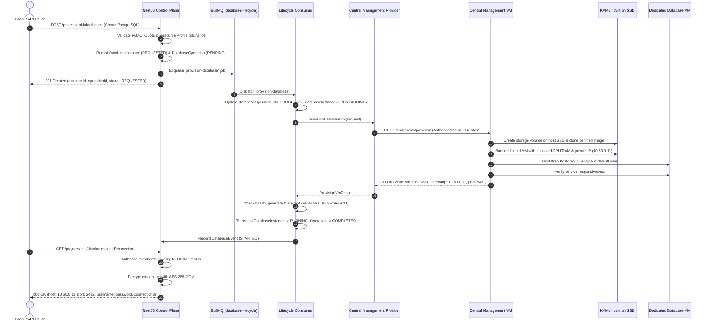

# Central Management VM — Technical Architecture & Integration Contract

## 1. Overview & Architecture Hierarchy

The **Multi-DBaaS (M-DBaaS)** platform employs a three-tier infrastructure model:

1. **Control Plane Backend (NestJS)**:
   - Manages tenant identity, projects, RBAC, quotas, operation logs, and credential encryption.
   - Enqueues asynchronous lifecycle jobs via BullMQ without holding client HTTP requests open.
   - Interacts with infrastructure exclusively via the `IInfrastructureProvider` interface.
   - **Never** directly executes hypervisor/KVM shell commands or holds raw Docker socket permissions.

2. **Central Management VM (Privileged Infrastructure Layer)**:
   - Dedicated management virtual machine deployed on the platform's private subnet (`10.50.0.2/24`).
   - Receives strongly typed, authenticated REST requests from the backend control plane.
   - Interfaces directly with KVM/libvirt and the host hypervisor.
   - Allocates dedicated virtual disks on local SSD storage volumes for each customer database instance.
   - Bootstraps and configures dedicated customer virtual machines.
   - Performs automated health checks and returns telemetry/status to the backend.

3. **Dedicated Customer Database VMs**:
   - Each customer-requested database instance runs in its own dedicated, isolated VM (e.g., PostgreSQL VM, MongoDB VM, Qdrant VM, Neo4j VM).
   - Assigned an isolated private IP address (e.g. `10.50.0.11`, `10.50.0.12`).
   - Database ports are **not** exposed directly to the public internet by default.
   - Traffic flows strictly through the platform's authorized network routing layer.

---

## 2. Infrastructure Flow Diagram



---

## 3. Central Management VM REST API Specification

The Central Management VM exposes a dedicated management REST service. All requests require mutual TLS (mTLS) or a bearer secret token (`Authorization: Bearer <CENTRAL_MANAGEMENT_API_KEY>`).

### A. Provision Database VM
* **Endpoint**: `POST /api/v1/vms/provision`
* **Request Payload**:
  ```json
  {
    "databaseId": "33333333-3333-3333-3333-333333333333",
    "projectId": "22222222-2222-2222-2222-222222222222",
    "engineType": "POSTGRESQL",
    "engineVersion": "16",
    "resources": {
      "cpuCores": 1,
      "ramMb": 1024,
      "storageMb": 5120
    },
    "credentials": {
      "username": "dbaas_admin",
      "password": "temporary-bootstrap-password"
    },
    "network": {
      "subnet": "10.50.0.0/24"
    },
    "tags": {
      "databaseName": "production-pg",
      "certifiedImage": "dbaas-image-postgres-16-v1.qcow2"
    }
  }
  ```
* **Response**:
  ```json
  {
    "vmId": "vm-post-33333333",
    "status": "RUNNING",
    "internalIp": "10.50.0.11",
    "port": 5432,
    "metadata": {
      "hypervisorDomain": "m-dbaas-guest-33333333",
      "allocatedSsdMb": 5120,
      "qcowPath": "/var/lib/libvirt/images/dbaas-33333333.qcow2"
    }
  }
  ```

### B. VM Lifecycle Actions
* `GET /api/v1/vms/:vmId/status` — Returns VM state (`RUNNING`, `STOPPED`, `ERROR`), CPU usage %, RAM usage, and uptime seconds.
* `POST /api/v1/vms/:vmId/start` — Triggers hypervisor domain startup.
* `POST /api/v1/vms/:vmId/stop` — Triggers ACPI graceful shutdown.
* `POST /api/v1/vms/:vmId/restart` — Triggers domain reboot.
* `DELETE /api/v1/vms/:vmId` — Shuts down domain, unmounts and removes SSD storage volume, and releases IP allocation.
* `GET /api/v1/vms/:vmId/health` — Executes TCP/protocol-level probe against database port.
* `GET /api/v1/vms/reconcile` — Lists all active domains and their internal network allocations.

---

## 4. Phase 4 Implementation & Simulation Boundaries

In **Phase 4**, the backend control plane integrates with:
1. **`MockInfrastructureProvider` (Default)**:
   - In-memory stateful provider with zero external dependencies.
   - Generates simulated VM identifiers, realistic IP assignments (`10.50.0.x`), and mock connection metadata.
   - Supports configurable failure modes (`PROVISION_FAIL`, `START_FAIL`, `HEALTH_FAIL`) for verifying BullMQ retry backoff and compensation cleanup.
2. **`LocalDevelopmentProvider`**:
   - Controlled simulation provider returning explicit diagnostic tags (`isSimulated: true`).
3. **`CentralManagementProvider`**:
   - Complete HTTP client implementation adhering to the REST contract above. Ready for live integration when the Central Management VM is provisioned.

---

## 5. Unimplemented Features (Deferred to Future Infrastructure Phases)
* Direct hypervisor socket mounting (`/var/run/libvirt/libvirt-sock`).
* Host nftables, NAT firewall rules, and physical bridge device configuration.
* Automated KVM guest image baking and cloud-init templating scripts.
* End-to-end WireGuard tunnel handshakes for external client connections.
* Multi-node cluster orchestration across physical server racks.
